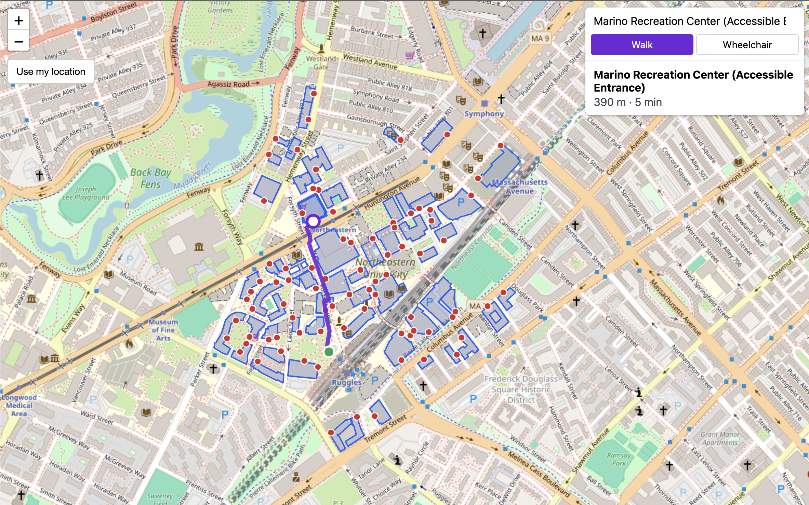
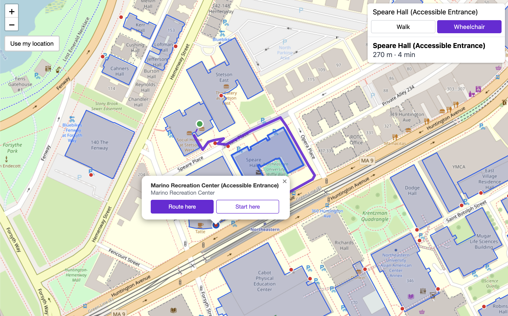
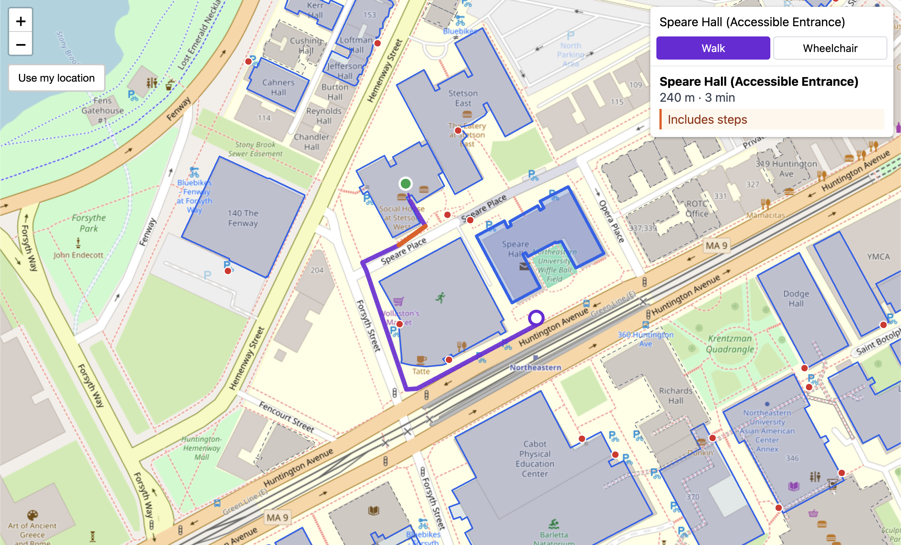
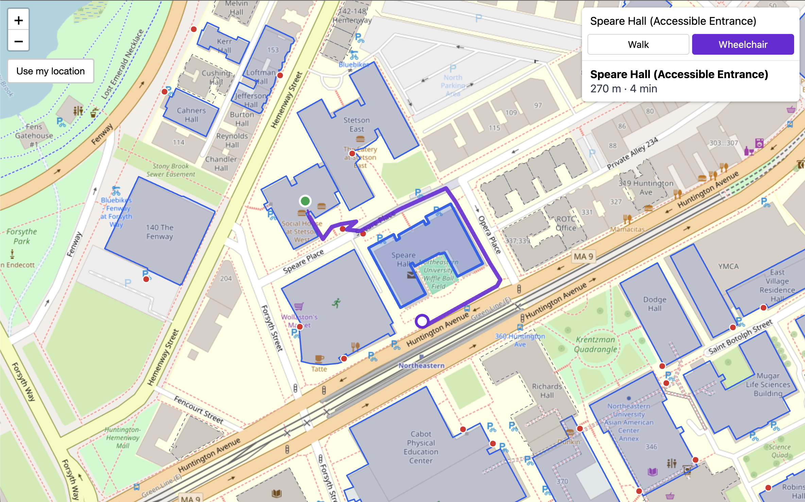

# Campus Navigator

Campus navigation that routes you to a building's **entrance**, not just the building.

<!-- TODO: live demo link once hosted, e.g.
**Live demo:** https://app.example.com
-->

Map apps usually route you to a building as a single point. On a campus, a building can have five or more doors, and only some of them are accessible. Campus Navigator models each entrance as its own routable point and picks the best door for how you're travelling: walking, or wheelchair-accessible paths only.

The first supported campus is **Northeastern University (Boston)**. The code is campus-agnostic: every campus is just a folder of CSV files.



## Features

- **Route to the best entrance** of a building for your mode, or to a specific door you pick on the map.
- **Walk and wheelchair modes.** Wheelchair routes use only path segments known to be accessible.
- **Steps warnings.** Walking routes highlight segments with steps or unverified accessibility.
- **Search** for buildings and places, including door names that act as aliases (e.g. "ISEC").
- **Start from your GPS location**, or click anywhere on the map.
- **Clear "no route" answers:** too far from any path, building has no mapped entrances, or no connecting path.

| Door popup | Steps warning | Wheelchair mode |
|---|---|---|
|  |  |  |


## Quick start

Requirements: Python 3.10+ (developed on 3.13). Node 22+ only if you want to run the frontend tests.

```bash
cd server
python3 -m venv .venv
.venv/bin/pip install -r requirements.txt
.venv/bin/uvicorn main:app
```

Open http://localhost:8000. The backend serves both the API and the frontend.

To use a different data folder, set `CAMPUS_DATA=/path/to/data` before starting the server.

### Trying it on a phone

- **Same Wi-Fi, no GPS:** start the server with `--host 0.0.0.0` and open `http://<your-laptop-ip>:8000`. You can set the start by tapping the map.
- **With GPS:** browsers only allow location on `https` pages (or `localhost`). A quick option is a tunnel, e.g. `cloudflared tunnel --url http://localhost:8000`. Note that the tunnel URL is publicly reachable while it runs.

## Tests

```bash
cd server && .venv/bin/pytest   # backend: loader, routing, query layer, API
node --test app/                # frontend helpers (formatting, request params, messages)
```

The backend tests use a small fake campus in `server/tests/fixtures/tiny-campus/`.

## How it works

```
app/        Frontend: Leaflet + plain JavaScript, no build step
server/     Backend: Python + FastAPI
  loader.py   loads and validates every campus under data/; bad data stops the server
  routing.py  Dijkstra shortest path with pluggable cost functions
  query.py    search, GPS snapping, and route building
  api.py      thin HTTP layer
data/       One folder per campus: buildings.csv, nodes.csv, edges.csv, pois.csv
data-prep/  Offline scripts that produce data/ from raw sources (not used by the app)
```

Some design choices:

- **Buildings, nodes and POIs are separate.** Buildings are polygons only and are never part of the routing graph. Nodes are routable points (entrances and path waypoints). POIs are searchable labels attached to nodes.
- **One algorithm, many cost functions.** Walking and wheelchair routing are the same Dijkstra with a different cost function, so new modes don't need a new algorithm.
- **Your GPS point is snapped** to the nearest point on a path. The map draws the gap between you and the path as a dashed line.

### API

| Endpoint | Returns |
|---|---|
| `GET /campuses` | campus ids and map bounds |
| `GET /campuses/{id}/buildings` | building outlines (GeoJSON) and their entrances |
| `GET /campuses/{id}/search?q=` | matching buildings and places |
| `GET /campuses/{id}/route?lat=&lon=&to_building=\|to_poi=\|to_entrance=&mode=walk\|wheelchair` | the route polyline, distance, time and warnings, or a "no route" reason |

Interactive docs are at http://localhost:8000/docs while the server is running.

## Adding a campus

Create `data/<campus-id>/` (lowercase letters, digits and hyphens) with four CSV files:

```
buildings.csv  building_id, name, polygon_geojson
nodes.csv      node_id, campus_id, building_id, floor, coord_system, x_or_lat, y_or_lon, type
edges.csv      from_node, to_node, cost, cost_unit, edge_type, accessible
pois.csv       poi_id, node_id, name, category, building_id, floor, accessible, notes
```

- Nodes with `type=entrance` must have a `building_id`.
- Edges are undirected and cost meters.
- `accessible` is `True`, `False`, or empty for unknown. Unknown counts as not accessible for wheelchair routing.

The server validates every campus at startup and refuses to start if any file is invalid, so errors show up immediately with the file and row.

Northeastern's data was produced by the scripts in `data-prep/scripts/northeastern-boston/` (they need their own venv with `data-prep/requirements.txt`). The scripts read raw GeoJSON from `data-prep/raw/northeastern-boston/`, which was downloaded manually; see [Data sources](#data-sources).

## Status and roadmap

The outdoor MVP is complete for Northeastern. Planned next:

1. Add a second campus
2. Indoor, floor-by-floor navigation
3. Weather-aware and other cost functions

Known limitations:

- **Wheelchair routing checks paths, not doors.** It's currently safe because Northeastern's data contains only accessible entrances.
- **Route lines are straight between path nodes**, so they can cut corners on curved paths. Distances are still exact.
- **Map tiles come from OpenStreetMap's public tile server**, which is fine for development but not for a public deployment.

## Data sources

- Sidewalk and footpath network: © [OpenStreetMap](https://www.openstreetmap.org/copyright) contributors, available under the Open Database License (ODbL), fetched with [OSMnx](https://github.com/gboeing/osmnx).
- Northeastern accessible entrances and building outlines: Northeastern University's public ArcGIS FeatureServer (org `S8KZ4xiwVgqpYP63`), from the layers `AccessibleEntrance` (82 points) and `Boston_Buildings_(Internal)_view` (114 polygons, filtered to the 104 Boston-campus buildings with `Site_ID == "BO"`). Downloaded as GeoJSON in October 2026. This data belongs to Northeastern.
- Map display: [Leaflet](https://leafletjs.com/), with OpenStreetMap tiles.


## License

The OpenStreetMap-derived data in `data/` remains under the [ODbL](https://opendatacommons.org/licenses/odbl/). Northeastern's entrance and building data belongs to Northeastern University and isn't covered by this project's license.
